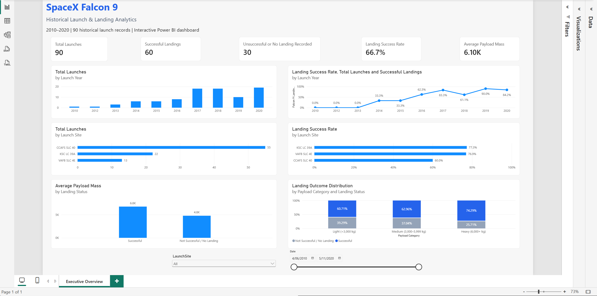

# SpaceX Falcon 9 Launch & Landing Analytics

### IBM Applied Data Science Capstone | Python · SQL · Machine Learning · Power BI

An end-to-end data science and business intelligence project analysing historical SpaceX Falcon 9 launches, booster recovery outcomes, launch sites, payload characteristics and predictive modelling.

This project extends the IBM Applied Data Science Capstone into a structured analytics portfolio, combining reproducible Python workflows with interactive dashboards and documented analytical outputs.

## Project Overview

Falcon 9's reusable first-stage booster is an important part of SpaceX's launch strategy. Understanding historical landing outcomes provides an opportunity to explore the relationship between mission characteristics and recorded recovery success.

This project investigates:

- How have Falcon 9 landing outcomes changed over time?
- How do recorded landing success rates differ across launch sites?
- How are payload mass and mission characteristics associated with recovery outcomes?
- What geographical patterns are visible across launch facilities?
- How effectively can machine-learning classifiers predict historical landing outcomes?

The project includes data acquisition, cleaning, SQL analysis, exploratory visualisation, geospatial mapping, predictive modelling and executive reporting.

## Technology Stack

| Category | Technologies |
|---|---|
| Programming | Python |
| Data analysis | pandas, NumPy |
| Data acquisition | HTTP requests, web scraping |
| SQL | SQLite |
| Visualisation | Matplotlib, Seaborn, Plotly |
| Geospatial analysis | Folium |
| Interactive applications | Plotly Dash |
| Machine learning | scikit-learn |
| Business intelligence | Microsoft Power BI, DAX |
| Development | Jupyter Notebook, VS Code, Git, GitHub |

## Power BI Executive Dashboard



The Power BI report provides an interactive executive-level overview of historical launch activity and recorded booster landing outcomes.

### Dashboard Features

- Total launch count
- Successful recorded landings
- Unsuccessful or no successful landing recorded
- Recorded landing success rate
- Average payload mass
- Annual landing success trends
- Launch-site comparisons
- Payload-category comparisons
- Interactive launch-site and date filters

**Open the Power BI report:**

[SpaceX_Falcon9_Analytics.pbix](dashboards/power-bi/SpaceX_Falcon9_Analytics.pbix)

**Read the Power BI workflow:**

[Power BI Workflow Documentation](dashboards/docs/Power_BI_Workflow_GitHub.md)

### Historical Dataset Snapshot

The primary historical analysis contains 90 launch records.

| Metric | Value |
|---|---:|
| Total launches | 90 |
| Successful recorded landings | 60 |
| Other recorded outcomes | 30 |
| Recorded landing success rate | 66.7% |
| Average payload mass | Approximately 6,100 kg |

These metrics describe the historical dataset used in the dashboard, not SpaceX's current operational performance.

**Outcome interpretation:** The binary landing classification identifies recorded successful landings. A value of 0 does not necessarily mean an attempted landing failed; it can also include missions without a successful landing recorded.

## Analytical Workflow

| Step | Analysis | File |
|---|---|---|
| 01 | Historical data collection | `notebooks/01_spacex_historical_data_collection.ipynb` |
| 02 | Data cleaning and wrangling | `notebooks/02_spacex_data_wrangling.ipynb` |
| 03 | Wikipedia web scraping | `notebooks/03_spacex_web_scraping.ipynb` |
| 04 | SQL analysis | `notebooks/04_spacex_sql_analysis.ipynb` |
| 05 | Exploratory visualisation | `notebooks/05_spacex_exploratory_visualisation.ipynb` |
| 06 | Geospatial analysis | `notebooks/06_spacex_geospatial_folium.ipynb` |
| 07 | Interactive Dash application | `notebooks/07_spacex_dash_dashboard.py` |
| 08 | Predictive modelling | `notebooks/08_spacex_predictive_modelling.ipynb` |

### Data Collection and Preparation

The workflow uses archived IBM capstone data and a historical Wikipedia snapshot.

Data preparation includes cleaning, validation, transformation and construction of the recovery outcome classification used in subsequent analyses.

### Exploratory and SQL Analysis

Python and SQL are used to investigate launch activity, recovery outcomes, payload characteristics and mission-level patterns.

The SQL mission dataset is distinct from the primary 90-record historical recovery dataset. Results should not be compared without accounting for their different record populations and definitions.

### Geospatial Analysis

Folium maps explore the geographical distribution of launch sites and landing outcomes.

Generated HTML maps are available in `notebooks/reports/`.

### Predictive Modelling

The machine-learning workflow evaluates classification approaches for predicting the historical binary landing outcome.

Saved outputs include:

- Model comparison results
- Model evaluation metrics
- Confusion matrix visualisation
- Serialized classifier artifact

Model results are exploratory and should not be interpreted as validated predictions of future SpaceX missions.

## Repository Structure

```text
IBM-Applied-Data-Science-Capstone/
├── dashboards/
│   ├── docs/
│   │   └── Power_BI_Workflow_GitHub.md
│   ├── power-bi/
│   │   └── SpaceX_Falcon9_Analytics.pbix
│   └── screenshots/
│       └── Executive-Overview.png
├── notebooks/
│   ├── 01_spacex_historical_data_collection.ipynb
│   ├── 02_spacex_data_wrangling.ipynb
│   ├── 03_spacex_web_scraping.ipynb
│   ├── 04_spacex_sql_analysis.ipynb
│   ├── 05_spacex_exploratory_visualisation.ipynb
│   ├── 06_spacex_geospatial_folium.ipynb
│   ├── 07_spacex_dash_dashboard.py
│   ├── 08_spacex_predictive_modelling.ipynb
│   ├── data/
│   │   ├── raw/
│   │   └── processed/
│   ├── images/
│   ├── models/
│   └── reports/
├── .gitignore
├── README.md
├── REPRODUCIBILITY.md
└── requirements.txt
```

## Reproducing the Analysis

To set up the Python environment, execute the notebooks and inspect the generated outputs, follow:

[REPRODUCIBILITY.md](REPRODUCIBILITY.md)

The Power BI report requires Power BI Desktop to open and edit the `.pbix` file.

## Scope and Limitations

- The project uses historical, archived data rather than a live SpaceX data feed.
- The different source datasets do not necessarily contain identical missions or observation counts.
- Landing classifications require careful interpretation, especially for missions without a recorded successful landing.
- Observed relationships between payload, launch site, time and recovery outcome are not evidence of causation.
- Predictive performance on historical data does not guarantee performance on future launches.
- Some workflows depend on external libraries, archived source material and local file paths.

## Project Background

Originally developed through the IBM Applied Data Science Capstone, this repository has been reorganised and extended as a personal data science portfolio project.

It demonstrates skills in data engineering fundamentals, analytical programming, SQL, visualisation, geospatial analytics, predictive modelling, business intelligence and technical documentation.

## Author

**Kanwar Kandolha**

[GitHub — Kan-21](https://github.com/Kan-21)
